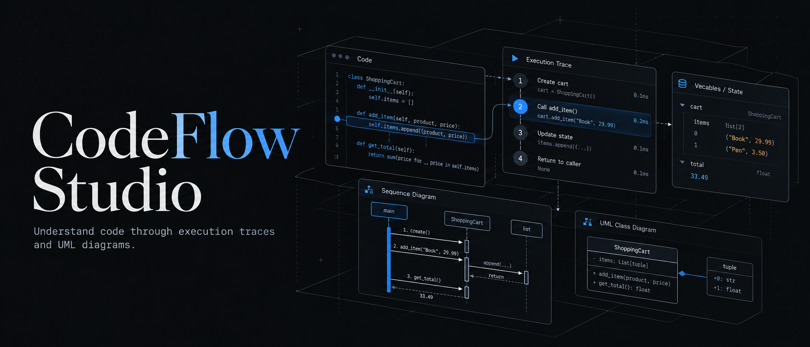

# CodeFlow Studio

CodeFlow Studio es una herramienta local y de código abierto para aprender cómo se organiza un programa y qué ocurre cuando se ejecuta. Permite analizar código Java y Python para generar diagramas UML estáticos y, cuando se solicita expresamente, observar y reproducir una ejecución real.

## ¿A quién puede servirle?

- **Estudiantes y personas autodidactas:** para relacionar cada línea de código con el flujo, las variables y la salida del programa.
- **Docentes:** para explicar en clase condiciones, bucles, llamadas y estados observados con ejemplos propios.
- **Desarrolladores que están aprendiendo Java o Python:** para explorar programas pequeños y entender su ejecución paso a paso.

El análisis estático es útil para estudiar la estructura sin ejecutar el código. Para generar una traza, utiliza únicamente programas de confianza: se ejecutan en tu propio ordenador con tus permisos.

En el modo **Básico**, pega o escribe código para crear un diagrama de actividad sin ejecutar el programa. Para Java con clases también está disponible el diagrama de clases. El modo **Avanzado** permite ejecutar localmente y explorar las trazas observadas. La ejecución requiere consentimiento explícito. La interfaz ofrece español e inglés, tema claro u oscuro, zoom del diagrama con Ctrl y la rueda del ratón, y exportación de diagramas a SVG o JPG.


## Funciones disponibles

- Análisis estático de Java y Python para generar diagramas de actividad; en Java, también diagramas de clases.
- En Java, expansión estática de expresiones ternarias y `switch` con flechas (`case ... ->`); las formas `case:` y las expresiones `switch` se muestran como pasos opacos.
- Trazado real de Java mediante Java Debug Interface (JDI) y de Python mediante `sys.settrace`.
- La ejecución Java compila con `--enable-preview` y la versión del JDK detectado.
- Reproducción de eventos y estados observados, con vistas de variables, pila de llamadas, salida, matrices y objetos cuando el adaptador puede observarlos.
- Explicación didáctica determinista en español e inglés, con niveles breve y detallado, sincronizada con el paso seleccionado.
- Diagrama de secuencia basado únicamente en llamadas y retornos observados en la traza; no se inventan llamadas a partir del código fuente.
- Distribución ajustable: redimensiona los paneles y reordena consola, estado, secuencia y explicación. La disposición se guarda localmente y se puede restaurar.
- Exportación de diagramas como SVG o JPG y de trazas como JSON, SVG o HTML autocontenido que se puede abrir sin conexión.

Los diagramas estáticos muestran estructura posible y no ejecutan ni evalúan el código. En una traza, cada instantánea se toma **antes** de la instrucción indicada; los efectos de esa instrucción aparecen en la instantánea siguiente. La reproducción recorre datos ya registrados.

## Explicación opcional con Ollama

El panel puede solicitar una explicación adicional a un modelo local de Ollama. Actívala y configura un modelo que ya esté instalado; la IA es opcional y CodeFlow Studio ofrece siempre la explicación determinista. Los hechos registrados se identifican como observados y el texto generado por IA se etiqueta aparte; puede contener errores y no constituye evidencia de ejecución. Si Ollama no está disponible, se conserva la explicación determinista.

Añade la configuración local opcional a `.codeflow.local.json`. Este ejemplo usa un marcador sustituible: reemplaza `modelo-local-ejemplo` por el nombre exacto de un modelo que ya tengas instalado. No hace falta descargar ningún modelo para usar CodeFlow Studio.

```json
{
  "ai": {
    "provider": "ollama",
    "model": "modelo-local-ejemplo",
    "baseUrl": "http://127.0.0.1:11434"
  }
}
```

La comunicación utiliza el endpoint local de chat de Ollama. Consulta la [documentación oficial de la API de chat](https://docs.ollama.com/api/chat). En esta máquina no hay un modelo local configurado. La integración se ha validado con un servidor simulado; la calidad y el comportamiento con un modelo real dependen del modelo instalado y requieren validación con ese modelo.

## Proyecto en desarrollo

CodeFlow Studio continúa en desarrollo activo. Se incorporarán nuevas funcionalidades, mejoras de visualización, optimizaciones y herramientas educativas en futuras versiones.

## Instalación desde el código fuente

El proyecto está en desarrollo y todavía no publica ejecutables. Para iniciarlo, clona el repositorio e instala sus dependencias:

```sh
git clone https://github.com/AngelmzDev/CodeFlow-Studio.git
cd CodeFlow-Studio
npm install
npm run build
npm start
```

Abre la dirección local que indique el CLI. Para crear un diagrama, escribe o pega código Java o Python y pulsa **Crear diagrama**. El análisis estático no ejecuta el programa.

## Requisitos

- Node.js 24 o posterior y npm.
- JDK 21 o posterior, con `jdk.jdi`, para analizar o ejecutar Java.
- Python 3.11 o posterior para analizar o ejecutar Python.

Comprueba los entornos detectados con `node src/cli.ts doctor`. Puedes seleccionar el JDK con `CODEFLOW_JAVA_HOME` o `JAVA_HOME`, y Python con `CODEFLOW_PYTHON`. También puedes definir las rutas locales `javaHome` y `python` en `.codeflow.local.json`; las variables de entorno tienen prioridad.

## Trazas y exportación desde el CLI

Estos comandos ejecutan código local en tu equipo; ejecútalos solo con fuentes de confianza:

```sh
node src/cli.ts trace examples/java/Main.java --allow-local-execution --entry Main --out trace.json
node src/cli.ts trace examples/java/Input.java --allow-local-execution --entry Input --stdin "5" --out input-trace.json
node src/cli.ts trace examples/python/sum.py --allow-local-execution --out python-trace.json
node src/cli.ts export trace.json --format html --out trace.html
```

Consulta [Seguridad](SECURITY.md) para conocer el modelo y sus límites.

No pegues claves, contraseñas ni código confidencial que no quieras guardar en el navegador o incluir en una traza exportada. El borrador del editor y la distribución de paneles se almacenan localmente en el navegador; puedes eliminarlos borrando los datos de este sitio.

## Alcance y documentación

Solo Java y Python tienen adaptadores operativos. La ejecución admite programas secuenciales de un archivo fuente. La actividad estática cubre un subconjunto de `if`, bucles, `return`, `break` y `continue`; las condiciones no se evalúan y las construcciones no compatibles pueden aparecer como opacas. Las instantáneas, vistas de variables y objetos dependen de la información que exponga cada entorno de ejecución. La ejecución usa los permisos del usuario y sus límites son salvaguardas de mejor esfuerzo, no aislamiento.

Consulta la [guía de usuario](docs/user-guide.md), la [guía para estudiantes](docs/guia-estudiantes.md), la [arquitectura](docs/architecture.md), la [guía de adaptadores](docs/adapters.md), el [formato de traza](docs/trace-format.md) y la [hoja de ruta](docs/roadmap.md). El formato neutral de intercambio no implica soporte para otros lenguajes. La visualización usa `@dagrejs/dagre` como dependencia de ejecución.

## Licencia

CodeFlow Studio se distribuye bajo la licencia MIT. Consulta [LICENSE](LICENSE).
